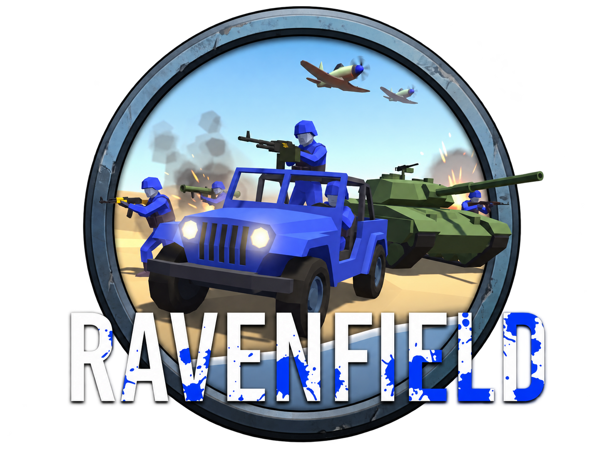
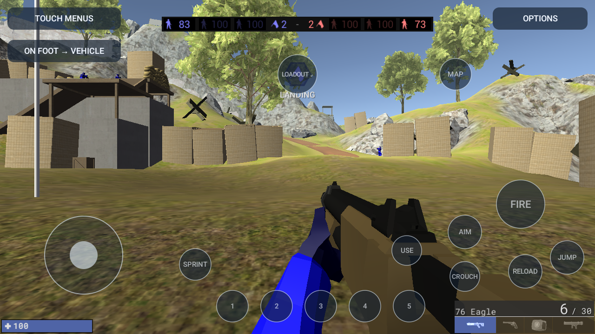

<div align="center">


# RavenDroid

**A native Android port of Ravenfield WebPort.**

**THIS PORT IS FULLY VIBECODED AND PROBABLY WONT GET ANY MORE UPDATES.**

Android 10+ · ARM64 · Wasmtime AOT · OpenGL ES 3 · Rust + Java

[**Download the full APK**](../../releases/download/v0.20/ravendroid-v0.20-full.apk) · [Release notes](../../releases/tag/v0.20) · [Build guide](docs/BUILDING.md)

</div>

---

RavenDroid runs a reviewed Unity WebGL build outside the browser using ahead-of-time compiled ARM64 code, native graphics and native audio. The full APK includes the game data and prepares it automatically on first launch.



*An actual Android emulator screenshot. It is not a phone performance benchmark.*

## Install and play

1. Download the **full ARM64 APK** from [Releases](../../releases/latest), approximately **1.02GB**.
2. Install it over the existing app to preserve saves and control layouts.
3. Launch RavenDroid and wait for the automatic preparation to finish. No separate game file or download is required.
4. Select **Launch game**, then use **Instant Action → Play → Deploy** in the game.

Allow approximately **1.5GB of additional free storage after installation** for extracted data and the native code cache. Existing verified data is reused. If preparation is interrupted, reopen the launcher or use **Prepare / verify game files**.

## Features

- Portrait launcher and landscape gameplay.
- Native OpenGL ES rendering and AAudio output.
- Movement, aiming, firing, crouching, reload and loadout controls.
- Separate, manually selected infantry and vehicle layouts.
- Drag controls to reposition them; adjust size, opacity and sensitivity; save layouts.
- Size and SHA-256 verification with atomic data installation.
- Offline full APK with bounded streaming preparation.

## How it works

```text
Android launcher
    └── verified game data + trusted ARM64 AOT
           └── Wasmtime owner thread
                  ├── GLES / EGL → SurfaceView
                  ├── audio mixer → AAudio
                  ├── virtual filesystem / saves
                  └── queued touch and keyboard input
```

This is a native host for a pinned WebAssembly build, not a rebuild from the original Unity project. It is not an official Ravenfield release.

## Validation and limitations

The current data-preparation implementation passed 34 Java tests and a full-size integration test using 256 MiB of Java heap. APK signing, artifact hashes, profile matching and16 KiB native alignment are checked before release. The native engine's earlier validation included 88 runtime and 7 GPU tests.

Actual performance depends on the device, scene and settings. Universal rendering correctness and stable 60 FPS are not claimed. The latest bundled launch flow has not yet been verified on a physical device. Vehicle profiles are selected manually; complete vehicle/aircraft gameplay coverage and background/lock-screen resume are not established.

See [validation](docs/VALIDATION.md), [controls](docs/CONTROLS.md), [architecture](docs/ARCHITECTURE.md) and [build instructions](docs/BUILDING.md).

## Source layout

| Directory | Purpose |
| --- | --- |
| `native-android/app/` | Launcher, data preparation, Android activities and touch controls |
| `native-runtime/` | Rust runtime, JNI, graphics, audio and AOT tooling |
| `tools/` | Preparation, build, resource-limit and verification helpers |
| `app/` | Separate legacy WebView prototype |
| `docs/` | Concise developer and user documentation |

Game payloads, SDKs, dependencies, local reports and generated builds are excluded from Git. The full installable package is available through the private release. Open-source dependency notices are included in the APK.
